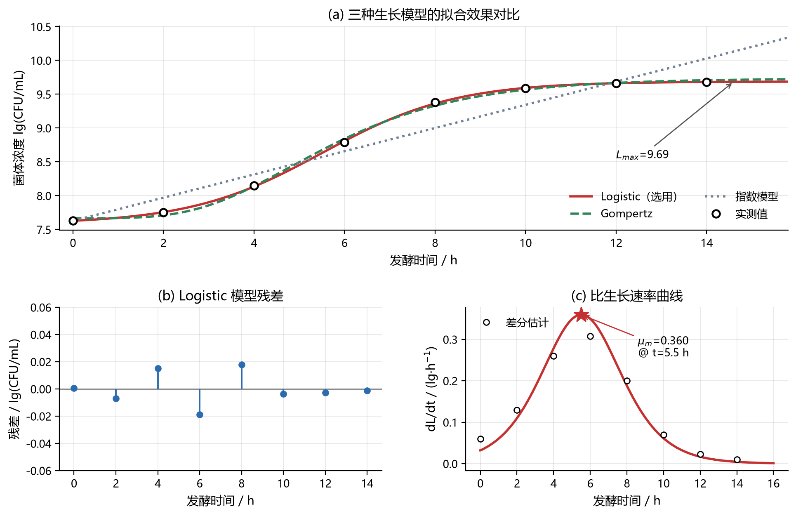
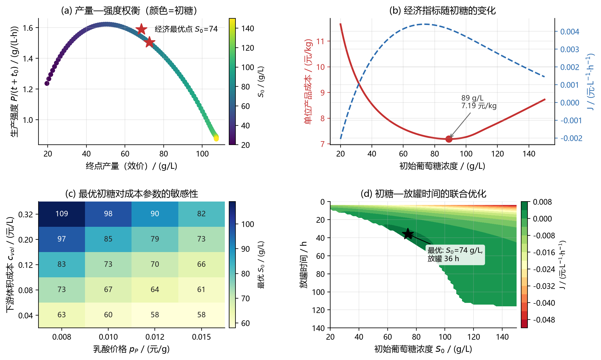

# 乳酸发酵工艺的规律与优化 —— 2026 新手数学建模竞赛 A 题

> 一份**完整可复现**的数学建模示例：从读题、看数据、选模型、估参数、做检验，到工艺优化与过程强化，最后写成一篇 28 页的竞赛论文。
>
> 适合第一次参加数学建模竞赛的同学：**照着目录顺序读，再对着代码跑一遍，就知道一篇论文是怎么"长"出来的。**





---

## 目录

| 目录/文件 | 说明 |
| --- | --- |
| [`paper/论文.pdf`](paper/论文.pdf) | 完整竞赛论文（28 页，LaTeX 源码在 `paper/`） |
| [`docs/建模教程.md`](docs/建模教程.md) | **先读这个**：从零开始的建模流程、每一步该问什么问题、常见坑 |
| [`docs/复盘指南.md`](docs/复盘指南.md) | **过阵子回来复习用**：30 分钟 6 步走完，含自测 10 问 |
| [`code/`](code/) | 全部 Python 代码（数据、拟合、优化、绘图） |
| [`results/`](results/) | 全部数值结果（JSON），论文里的每个数字都能在这里找到 |
| [`figures/`](figures/) | 全部插图（论文里的图都是代码生成的） |
| [`data/`](data/) | 原始数据（附件 A）、题面（PDF/Markdown/LaTeX） |

---

## 一、这道题在问什么

一次分批发酵，测了 8 个时间点的三个量：**菌体**（lg(CFU/mL)）、**乳酸**（g/L）、**残糖**（g/L）。另有一组 6 个初糖水平的终点对比试验。四个问题其实是一条链：

```
问题1  菌体怎么长            →  L(t) 的模型（Logistic）
问题2  生长、产酸、耗糖怎么联动 →  以 L(t) 为输入，Luedeking-Piret + 产物抑制
问题3  初糖该加多少、何时放罐  →  终点规律 + 经济优化
问题4  怎么改造工艺           →  既然瓶颈是产物抑制，就把乳酸移走
```

## 二、主要结论（先看结论，再看过程）

### 问题 1：菌体生长

$$L(t)=7.582+\frac{2.106}{1+e^{-0.683(t-5.511)}}\qquad[\lg(\mathrm{CFU/mL})]$$

- $R^2=0.99982$，RMSE $=0.011$（数据本身只精确到 0.01）
- **最大比生长速率 0.360 lg(CFU/mL)/h**（$t=5.51$ h），相当于 $\mu=0.83\ \mathrm{h^{-1}}$，倍增时间 **0.84 h**
- **最终菌体量 9.688**，即 $4.87\times10^{9}$ CFU/mL，比接种时增长 **114 倍**

### 问题 2：三者联动

$$\frac{\mathrm{d}P}{\mathrm{d}t}=\left(\alpha\frac{\mathrm{d}L}{\mathrm{d}t}+\beta X\right)\left(1-\frac{P}{P_m}\right),\qquad \frac{\mathrm{d}S}{\mathrm{d}t}=-\frac{1}{Y_{P/S}}\frac{\mathrm{d}P}{\mathrm{d}t}-m_s$$

- **每消耗 1 g 葡萄糖生成 0.99 g 乳酸**（$Y_{P/S}=0.989$，$R^2=0.9988$），与同型乳酸发酵的理论值 1.0 吻合
- 产酸来源：生长偶联 31.8%，非生长偶联 68.2%
- **产物抑制阈值 $P_m=9.91$ g/L** —— 这一条解释了一个"怪现象"：14 h 时乳酸 9.99 g/L、残糖还有 24.9 g/L，发酵却停了。**不是没糖，是被自己的产物憋停了。**

### 问题 3：初糖与放罐

- 终点产量：$P_\infty=\min\{0.961S_0,\ 109.9\}$，$R^2=0.9997$
- **临界初糖 $S_0^*=114.3$ g/L**：低于它糖能用完，高于它乳酸先撞上 110 g/L 的天花板，糖被剩下
- 预测 150 g/L 时残糖 **35.7 g/L**，实测 **35.7 g/L**
- **推荐：初糖 75~90 g/L，放罐 40~60 h**（经济最优 74 g/L/36.5 h；单位成本最低 89 g/L/60 h）

### 问题 4：移出乳酸

| 策略 | 单批产酸 | 时长 | 产出强度 | 残糖 |
| --- | --- | --- | --- | --- |
| 分批（不控酸） | 9.72 g/L | 14 h | 0.694 | 25.1 g/L |
| **移酸，维持 4 g/L** | **35.6 g/L** | 17.2 h | **2.07** | 0.49 g/L |
| 补料分批（总糖 115 g） | 97.5 g/L | 83.9 h | 1.34 | 0.84 g/L |

把酸移走，单批产量提高到 **3.6 倍**，糖利用率从 28% 提到 98%。

---

## 三、怎么跑起来

```bash
pip install -r requirements.txt
cd code
python main.py          # 依次跑完 Q1→Q4 并重绘所有图
```

| 脚本 | 作用 |
| --- | --- |
| `common.py` | 数据、评价指标（R²/RMSE/MAPE/AIC/BIC）、绘图风格 |
| `growth.py` | 五种生长模型的定义 |
| `q1_growth.py` | 问题 1：五模型拟合、AIC 比较、自助法置信区间、留一交叉验证 |
| `q2_coupled.py` | 问题 2：产率模型、Luedeking-Piret、三种耦合模型对比、参数不确定度 |
| `q3_opt.py` | 问题 3：终点模型、Haldane、动力学模型、二维经济寻优、敏感性 |
| `q3_robust.py` | 问题 3：留一重拟合的稳健性检验 |
| `q4_strategy.py` | 问题 4：原位移酸（ISPR）与补料分批的定量比较 |
| `make_figures.py` | 生成论文全部 7 张插图 |

编译论文（需要 TeX Live / MiKTeX + `ctex`）：

```bash
cd paper
xelatex main.tex && xelatex main.tex
```

---

## 四、这个仓库想教你的三件事

1. **建模不是"套公式"，是"回答问题的顺序"。** 先问"这些数据长什么样"，再问"什么机制能产生这个形状"，最后才问"参数是多少"。见 [建模教程](docs/建模教程.md) 第 1~3 步。
2. **检验比拟合重要。** 论文里每个模型都给了 $R^2$ 之外的证据：残差结构、AIC/BIC、留一交叉验证、自助法置信区间、外推检验。尤其问题 2 的"外推失败"案例，是刻意保留的反面教材。
3. **结论要能被数据检验。** "150 g/L 时残糖 35.7 g/L"这个预测是模型**先说、数据后验**的，比任何 $R^2$ 都有说服力。

---

## 五、回头复习怎么用

过一两周再打开这个仓库，不用重读 28 页论文，按 [`docs/复盘指南.md`](docs/复盘指南.md) 走：

```
第1步 5分钟  只看摘要里的 4 个数字
第2步 8分钟  遮住答案，自己从图里推结论
第3步 10分钟 跟着 q1_growth.py 走一遍拟合流程
第4步 8分钟  看 Q2 的"外推失败"反面案例
第5步 5分钟  拆解 Q3 的目标函数（每一笔钱）
第6步 4分钟  理清 Q4 的"瓶颈决定策略"逻辑
```

最后做 10 道自测题，答对 7 道以上就算吃透了。

---

## 六、说明

- 原始数据来自竞赛附件 A（`data/附件A_发酵实验数据.xlsx`），改编自公开科研数据。
- 试验一与试验二的菌株、温度、pH 控制方式不同，本文**分开建模**，只在机理层面互相印证，不交换参数。
- 代码使用 Python 3.12 + NumPy + SciPy + Matplotlib，无其他依赖。
